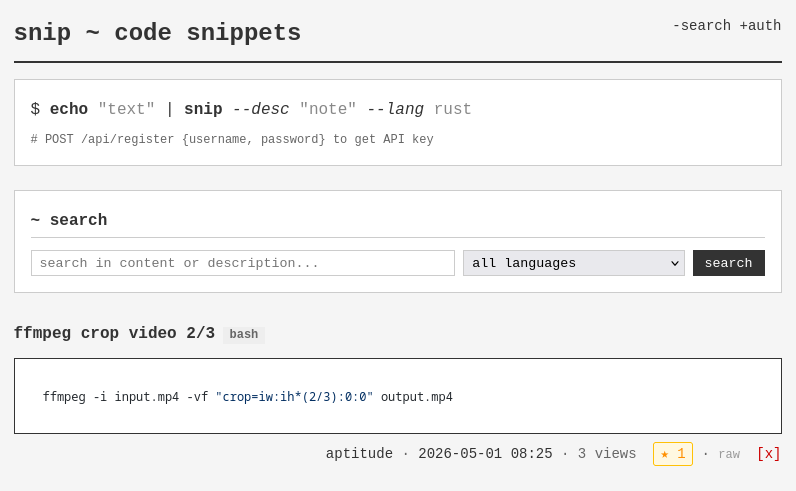

# Snip

A minimal, self-hosted snippet sharing service. Share code snippets via web UI, CLI, or API.



## Features

- **Web UI** - Syntax highlighting and expandable previews for long snippets
- **CLI Tool** - Share files or piped text, with language detection and concise terminal feedback
- **API** - RESTful API for integration
- **Self-hosted** - Single binary + SQLite, no external dependencies
- **Multi-platform** - Linux (x86_64, aarch64), macOS, Windows

## Quick Start

### 1. Install

**Arch Linux** (recommended):
```bash
yay -S snip-rs
# Start the server
sudo systemctl enable --now snip
```

**Docker**:
```bash
# Run pre-built image
docker pull skorotkiewicz/snip:latest # pull latest image
docker run -d -p 3000:3000 -v snip_data:/data skorotkiewicz/snip:latest

# Or build locally
docker build -t snip .
docker run -d -p 3000:3000 -v snip_data:/data snip

# Or use Docker Compose
docker compose up -d
```

**From source**:
```bash
cargo install --path .
```

Start the server with `snipd`. Source installs create `snip.db` in the working directory.

### 2. Create Account

```bash
# Register a new account
snip register myusername
# Enter password when prompted

# Or login to existing account
snip login myusername

# Or register on demo server
snip --server https://pb.sekor.eu.org register myusername
```

Credentials are saved to `~/.config/snip/config.json`, with owner-only file permissions on Unix. Saved API keys apply only to their configured server. Explicit flags override environment variables, which override saved configuration.

### 3. Share Snippets

```bash
# Pipe any content directly
echo 'console.log("hello")' | snip --desc "example" --lang javascript

# Or share a file; language and title come from its name
snip main.rs

# View the snippet
snip get 42

# Posting prints the share URL, so it also works in scripts
url=$(snip main.rs)
echo "Check this: $url"
```

## CLI Usage

### Authentication

Usernames accept 3-32 ASCII letters, digits, underscores, or hyphens. Passwords require at least 6 Unicode characters and at most 72 UTF-8 bytes.

```bash
snip register <username>   # Create new account
snip login <username>      # Login to existing
snip whoami                # Show current user
snip logout                # Clear saved credentials
```

### Post Snippets

Run `snip` or `snip -h` for a short list of useful commands. Help shows the current account and omits login and register when an API key is ready. Use `snip --help` for advanced commands and connection options. Hidden commands remain callable, so `snip login another-user` still switches accounts. Help uses local credentials and does not contact the server.

```bash
# Share a file, guessing syntax from its extension
snip main.rs

# Override the description and syntax
snip LICENSE -d "Project license" -l markdown

# An explicit post works the same way; -- ends option parsing
snip post -d "" -l markdown -- LICENSE

# Pipe text, or use - explicitly for stdin
echo "code here" | snip
cat script.py | snip - -l python

# Available languages: bash, c, cpp, css, go, html, java, javascript,
# json, kotlin, lua, markdown, php, python, ruby, rust, scala,
# shell, sql, swift, typescript, yaml, zig (and plaintext)
```

File posts use the filename as their default description. `-d ""` leaves it empty. Piped input has no automatic description or language. Files and stdin accept UTF-8 text up to 5000 Unicode characters.

Posting writes only the share URL to stdout. In a terminal, a short scissors message appears on stderr. Redirects and command substitution keep stdout clean.

### Browse Snippets

```bash
snip get <id>              # View snippet by ID
snip search "query"        # Search all snippets
snip search "fn main" --lang rust   # Search with language filter
snip delete <id>           # Delete your snippet
```

### Shell Completions

```bash
# Add to ~/.bashrc or ~/.zshrc
eval "$(snip complete zsh)" 
```

**Available shells:** `bash`, `zsh`, `fish`, `elvish`, `powershell`

## Web Interface

Open `http://localhost:3000` to:
- Browse all snippets
- Filter by language
- Search by content
- View user profiles (`/u/username`)
- Get raw content (`/raw/123`)

## Server Configuration

### Environment Variables

| Variable | Default | Description |
|----------|---------|-------------|
| `DATABASE_URL` | `sqlite:snip.db` | SQLite database path |
| `SNIP_HOST` | `0.0.0.0` | Bind address |
| `SNIP_PORT` | `3000` | Port number |

### Systemd (Manual Install)

```bash
sudo cp snipd /usr/bin/
sudo cp systemd/snip.service /etc/systemd/system/
sudo systemctl daemon-reload
sudo systemctl enable --now snip
```

### Docker Compose

```yaml
services:
  snip:
    build: .
    image: snip
    ports:
      - "3000:3000"
    volumes:
      - snip_data:/data
    environment:
      DATABASE_URL: sqlite:/data/snip.db
      RUST_LOG: info
    restart: unless-stopped

volumes:
  snip_data:
```

## API Reference

Successful endpoints return JSON except raw content and empty deletion responses. Errors return plain text. Timestamps use RFC 3339 in UTC.

SQLite stores endpoint rate limits and view counts. Registration allows 5 attempts per hour per peer IP; login allows 10 attempts per minute per username. Snippet creation and forks allow 10 attempts per minute per user, comments allow 30, and password changes allow 10. These limits survive server restarts. The global limit replenishes 10 requests per second per peer IP with a burst of 60. Peer IP means the direct TCP client, including a reverse proxy.

Snippet content allows 5000 Unicode characters, descriptions 255, and comments 1000. Comments support up to 8 nested levels.

### Authentication

```bash
# Register
POST /api/register
{"username": "alice", "password": "secret123"}
→ {"id": 1, "username": "alice", "api_key": "xxx"}

# Login
POST /api/login
{"username": "alice", "password": "secret123"}
→ {"username": "alice", "api_key": "xxx"}
```

### Snippets

```bash
# Create (requires API key)
POST /api/snippets -H "X-API-Key: xxx"
{"content": "code", "description": "...", "language": "rust"}

# Get by ID
GET /api/snippets/123

# Delete own snippet
DELETE /api/snippets/123 -H "X-API-Key: xxx"

# List all
GET /api/snippets

# Search
GET /api/search?q=hello&lang=rust&limit=10

# List user's snippets
GET /api/users/alice/snippets

# List nested comments for a snippet
GET /api/snippets/123/comments

# Create a comment or reply (requires API key)
POST /api/snippets/123/comments -H "X-API-Key: xxx"
{"content": "nice snippet", "parent_id": null}

# Like / unlike a comment (requires API key)
POST /api/comments/456/like -H "X-API-Key: xxx"
DELETE /api/comments/456/like -H "X-API-Key: xxx"

# Delete your own comment or moderate comments on your snippet
DELETE /api/comments/456 -H "X-API-Key: xxx"
```

### Pages

- `GET /` - Web frontend
- `GET /s/{id}` - View snippet page
- `GET /raw/{id}` - Raw snippet content (text/plain)
- `GET /u/{username}` - User profile

## Architecture

- **Backend**: Axum (Rust) + SQLite, with no cache service required
- **Frontend**: Vanilla HTML/JS embedded in the binary
- **CLI**: Rust + clap + reqwest
- **Syntax Highlighting**: highlight.js (CDN)

| Module | Responsibility |
|--------|----------------|
| `server.rs` | Opens SQLite, applies migrations, wires routes and middleware, handles shutdown |
| `auth_user.rs` | Resolves API keys before handlers run |
| `handlers.rs` | Validates requests and implements snippet, account, and comment operations |
| `database.rs` | Owns the SQLx pool and enforces atomic fixed-window rate limits |
| `app_error.rs`, `middleware.rs` | Map failures to HTTP responses and prevent response caching |
| `web.rs` | Embeds the UI, which calls the same HTTP API as the CLI |
| `cli.rs` | Manages local credentials and makes HTTP requests |

SQLite is the source of truth for views, rate limits, stars, forks, and comments. Fork counts come from fork rows. The UI collapses long code blocks visually; API and raw responses always return the full content.

## Development

Run `just check` for formatting and Clippy, `just test` for Rust tests, and `just web-test` for browser tests. Browser tests require Node.js and Chromium and use no npm dependencies. Set `CHROMIUM` if the executable has a different name.

## License

MIT
